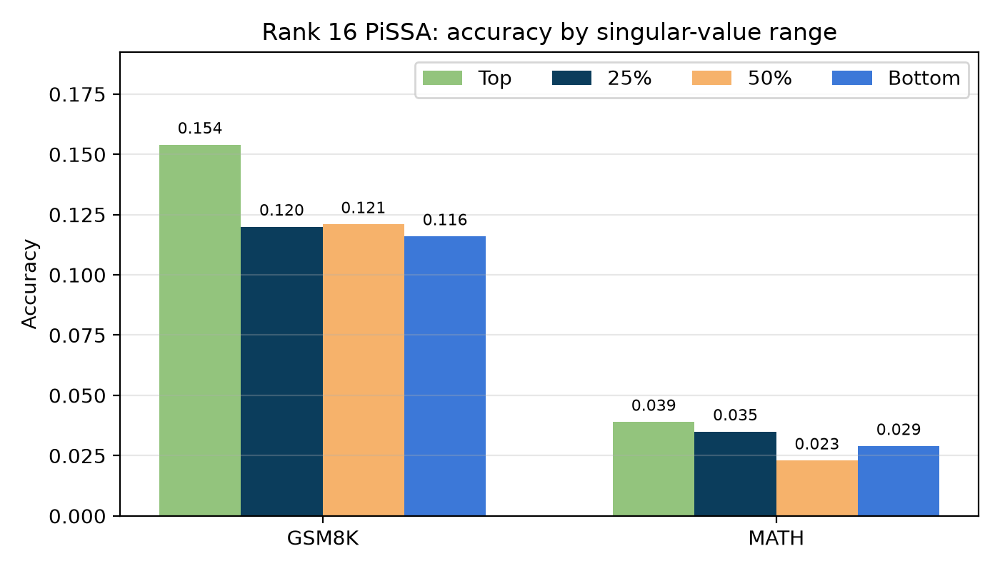
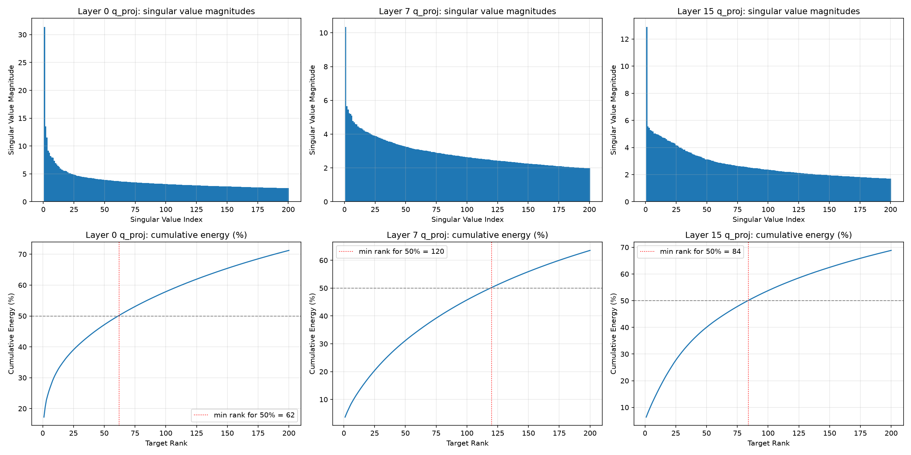

# BigData2026 Assignment 1: Analysis of SVD for Fine-Tuning LLMs

Fine-tuning `meta-llama/Llama-3.2-1B` on MetaMathQA with PiSSA-style SVD adapters, evaluated on GSM8K and MATH
(1,000 test questions each, accuracy). The code is the course starter code
([nycubigdata-2026fall/BigData2026-Assignment1](https://github.com/nycubigdata-2026fall/BigData2026-Assignment1)),
itself adapted from [PiSSA](https://github.com/MuLabPKU/PiSSA) (Meng et al., NeurIPS 2024), with the TODOs for
Questions 1 to 4 completed.

## Files

| Path | Content |
|---|---|
| `finetune_q1-q3.ipynb` | Questions 1 to 3: baseline, PiSSA fine-tuning at ranks 16 / 64 / 256, training time, singular-value ranges |
| `finetune_q4.ipynb` | Question 4: SVD of `q_proj` in layers 0, 7 and 15 of the original model |
| `results/benchmark_results.csv` | All runs in one table (accuracy, correct counts, unparsed answers, training minutes, trainable parameters, final loss) |
| `results/runs/` | Per-run summaries, predictions (one JSON line per test question), training-loss history, training time |
| `results/q4/` | Question 4 summary (minimum ranks, cumulative energy) and the six charts |
| `results/figures/` | Charts used in the report |
| `results/executed_notebooks/` | The notebooks as they were executed, with outputs |

## Changes to the starter code

All settings from the assignment's "Basic Settings" are unchanged: Llama-3.2-1B, target modules
`q_proj, k_proj, v_proj, o_proj, gate_proj, up_proj, down_proj`, 1 epoch, learning rate 2e-5, FP16 training,
256 new tokens at evaluation, and the provided answer parser. MetaMathQA uses the first 25,000 samples
(24,975 remain after the length filter).

- **Question 1** (`MANUAL_RUNS`): ranks 16, 64 and 256 with `component='default'`, and `RUN_FRESH_BASELINE = True`.
- **Question 2** (`train_one_task`): a `time.perf_counter()` timer between the tagged start and end of training.
  The function returns the training seconds, and each run's summary stores `train_seconds` and `train_minutes`.
- **Question 3** (`pissa_from_linear_exact`): three new values for `component`, all with rank 16:
  `q25` starts at `len(S) // 4`, `q50` starts at `len(S) // 2`, and `bottom` starts at `len(S) - rank`.
  An assertion checks that the selected range stays inside the spectrum.
- **Question 4** (`finetune_q4.ipynb`): full SVD of `model.model.layers[k].self_attn.q_proj.weight` for
  k = 0, 7, 15, cumulative energy `cumsum(S**2) / sum(S**2) * 100`, the minimum rank reaching 50%, and a bar chart
  (singular values) plus a line chart (cumulative energy) of the first 200 values for each layer.
- **Running outside Kaggle**: the Hugging Face login falls back to the `HF_TOKEN` environment variable when Kaggle
  secrets are unavailable, and these optional environment variables are read with Kaggle-compatible defaults:
  `A1_RESULT_ROOT` (output folder), `A1_RUNS` (a JSON list to run a subset of `MANUAL_RUNS`),
  `A1_RUN_BASELINE` (`1`/`0`) and `A1_MODEL_ID`.

## How the results were produced

The notebooks ran on a lab server with NVIDIA RTX A6000 (48 GB) GPUs instead of Kaggle's 2 x T4, one run per GPU,
so `DataParallel` was not used. The effective batch size is unchanged (micro-batch 8 x 16 accumulation steps = 128).
The three Question 1 runs ran one after another on the same GPU so that their training times are comparable.

```bash
# example: Question 1 runs on GPU 1
CUDA_VISIBLE_DEVICES=1 A1_RESULT_ROOT=results/q1 A1_RUN_BASELINE=0 \
A1_RUNS='[{"rank":16,"component":"default"},{"rank":64,"component":"default"},{"rank":256,"component":"default"}]' \
jupyter nbconvert --to notebook --execute finetune_q1-q3.ipynb --ExecutePreprocessor.timeout=-1
```

## Results

### Question 1: accuracy by target rank (top singular values)

| Accuracy | Original LLM | Fine-tuned (rank 16) | Fine-tuned (rank 64) | Fine-tuned (rank 256) |
|---|---|---|---|---|
| GSM8K | 0.033 | 0.154 | 0.206 | 0.269 |
| MATH | 0.001 | 0.039 | 0.051 | 0.052 |

### Question 2: training time

| | Rank 16 | Rank 64 | Rank 256 |
|---|---|---|---|
| Training time (min.) | 20.00 | 20.95 | 27.43 |
| Trainable parameters | 11.27 M | 45.09 M | 180.36 M |

### Question 3: rank 16 from different parts of the singular-value spectrum

| Accuracy | Top 16 | 25% position | 50% position | Bottom 16 |
|---|---|---|---|---|
| GSM8K | 0.154 | 0.120 | 0.121 | 0.116 |
| MATH | 0.039 | 0.035 | 0.023 | 0.029 |



### Question 4: minimum target rank for at least 50% cumulative energy (`q_proj`)

| | Layer 0 | Layer 7 | Layer 15 |
|---|---|---|---|
| Minimum target rank | 62 | 120 | 84 |



## References

- Hu, E. J., et al. "LoRA: Low-rank adaptation of large language models." arXiv:2106.09685 (2021).
- Meng, F., Wang, Z., and Zhang, M. "PiSSA: Principal singular values and singular vectors adaptation of large
  language models." NeurIPS 37 (2024): 121038-121072. Code: https://github.com/MuLabPKU/PiSSA
